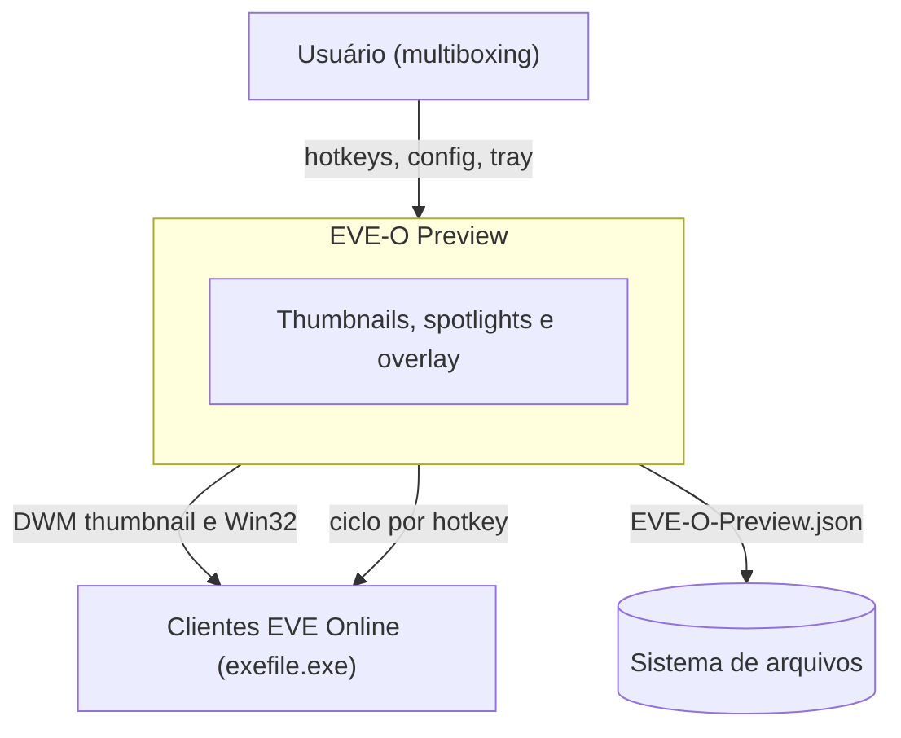
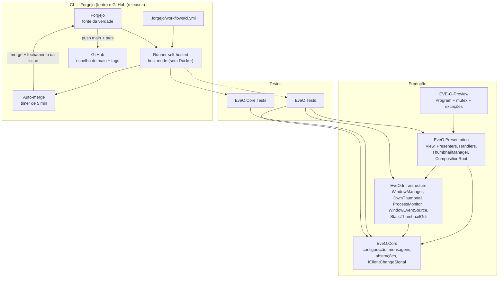
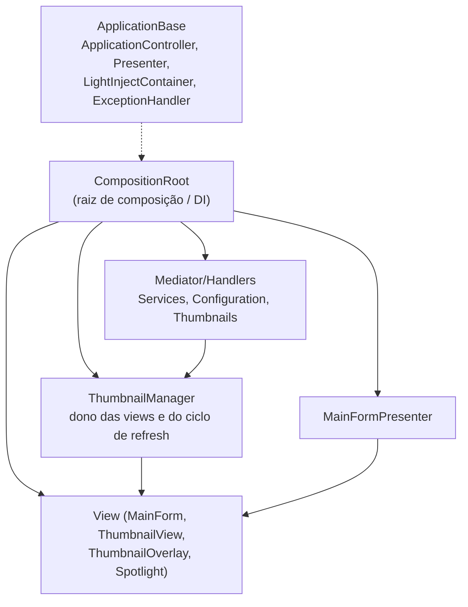
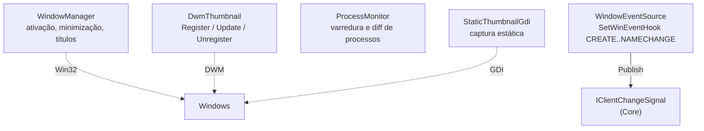
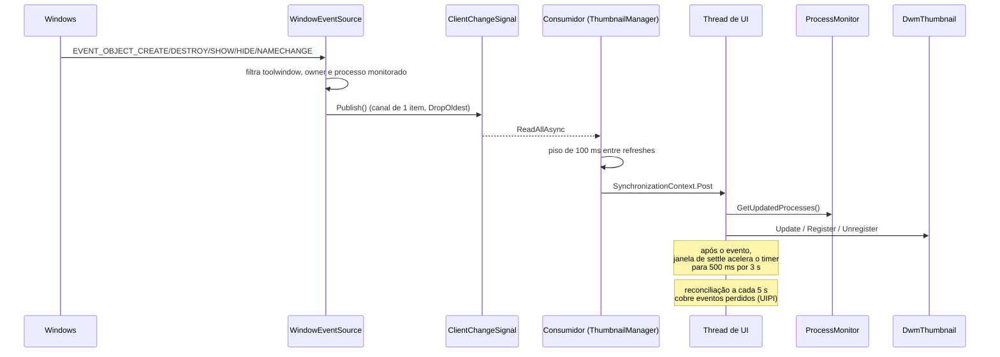

# Documentação de Arquitetura C4

*Atualizada em 2026-11-20 — Fase 2.1 (camadas), Fase 2.2 (refresh event-driven) e Fase 3 (Forgejo como fonte, GitHub como espelho de release).*

> Ver `docs/audits/spike-forgejo.md` para as medições e o plano da Fase 3.

Para a visão de conjunto e as regras de dependência, ver `docs/architecture/README.md`.
Decisões: `docs/audits/adr-00*.md`.

---

## Visão geral

O sistema tem **quatro assemblies de produção** e dois de teste:

| Assembly | Papel | Depende de |
|---|---|---|
| `EveO.Core` | domínio, configuração, mensagens do Mediator, abstrações | nada de Windows |
| `EveO.Infrastructure` | interop Win32/DWM, processos, janelas, captura GDI | Core |
| `EveO.Presentation` | WinForms/WPF: views, presenters, handlers, `ThumbnailManager`, raiz de composição | Core, Infrastructure |
| `EVE-O-Preview` | `Program`: mutex, exceções, ciclo de vida | Presentation |
| `EveO.Core.Tests` | testes sem Windows | Core |
| `EveO.Tests` | testes com Windows (GDI, integração) | Core, Infrastructure, Presentation |

**Regra de ouro**: `EveO.Core` não referencia `System.Windows.Forms`, `System.Windows.Threading` nem
P/Invoke. Se algum tipo do Core puxar Windows, a camada está errada.

---

## 1. Contexto (Level 1)

O EVE-O não injeta nada no jogo: ele registra thumbnails de janelas alheias via DWM e reage a eventos
do sistema. Se o cliente rodar elevado e o EVE-O não, o Windows bloqueia a entrega de eventos (UIPI) —
por isso a reconciliação periódica existe.

---

## 2. Container (Level 2)

---

## 3. Component (Level 3)

### `EveO.Presentation`

### `EveO.Infrastructure`

---

## 4. Code (Level 4) — o ciclo de refresh

Este é o fluxo que a Fase 2.2 mudou (ADR-006). Antes: um `DispatcherTimer` de 500 ms varria processos a
2 Hz. Agora: eventos disparam o refresh e o timer só reconcilia.

Consequências medidas (7 clientes): CPU idle `1,45% → 0,52%`; criação de thumbnail `620 → 419 ms`.

---

## 5. ADRs

| ADR | Decisão | Status |
|---|---|---|
| ADR-001 | MVP vs MediatR coexistindo | aceito |
| ADR-002 | Abstração DWM via `IThumbnailProvider` | aceito |
| ADR-003 | JSON config (não JsonSchema) | aceito |
| ADR-004 | Sem Rx.NET na Fase 1 | aceito |
| ADR-005 | Sem DWM pooling na Fase 1 | aceito |
| ADR-006 | **Refresh event-driven** (`Channel<T>` + reconciliação 5 s) | aceito, implementado (#175) |
| ADR-007 | Virtualização de thumbnails | **rejeitada** (gate −20% inalcançável: máx. −12%) |
| ADR-008 | Pool de `DwmThumbnail` | **rejeitada** (registro 0,012 ms vs limite de 30 ms) |
